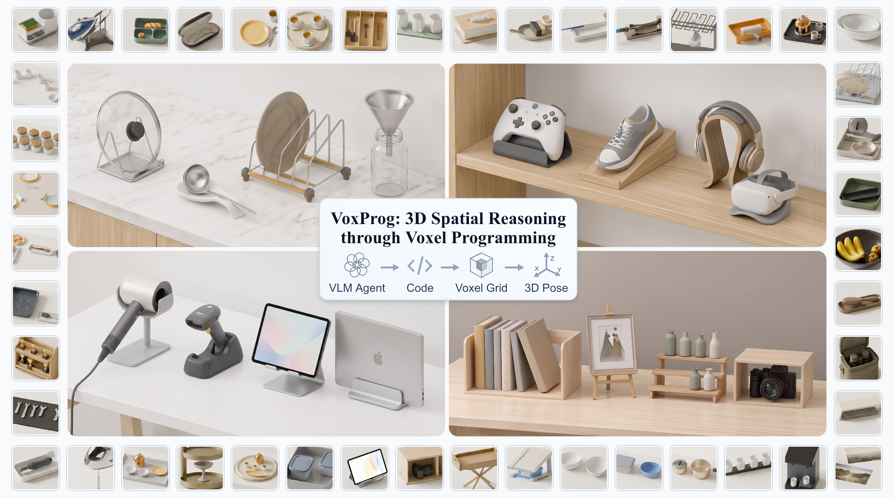
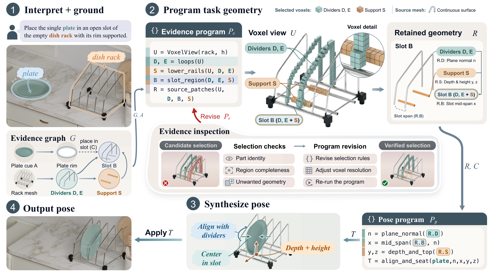

<h1 align="center">VoxProg 3D Spatial Reasoning through Voxel Programming</h1>

  <a href="https://github.com/zhichao-zhai">Zhichao Zhai</a>1 ·
  Menglei Zhao1 ·
  Guikun Chen1 ·
  Zihao Yan2 ·
  Kanzhi Wu2 ·
  Wenguan Wang1 ·
  Jun Xiao1

  1Zhejiang University &nbsp;&nbsp;
  2vivo Mobile Communication Co., Ltd., Shenzhen, China

  
  
  

  <b>Turning natural-language instructions into executable programs that reason over 3D geometry.</b>

  

## Overview

**VoxProg** enables VLM coding agents to solve open-ended 3D spatial tasks through **voxel programming**. Given an instruction and a scene, the agent writes Python programs that inspect object geometry, construct the spatial references needed for the task, and compute a 6-DoF placement pose. Visual and numerical feedback lets it refine both geometric selections and object placements.

The central idea is to expose local mesh surfaces as regular 3D grids that programs can inspect with array operations. An instruction such as *“place the plate upright in the rack”* becomes a concrete geometric procedure: find the dividers and support rails, construct the receiving slot, then align and seat the plate within it.

## How it works

  

1. **Interpret and ground.** Decompose the instruction into geometric references and locate visual anchors on the scene meshes.
2. **Construct geometric evidence.** Generate programs over local voxel views to select task-relevant surfaces, boundaries, and regions; inspect and refine these selections using execution feedback.
3. **Solve the placement.** Generate a pose program that measures the selected geometry and computes the object's rigid transformation, then refine it with rendered observations and contact or clearance diagnostics.

## VoxProg-Bench and results

**VoxProg-Bench** contains 71 open-ended placement tasks spanning functional use, geometric fit, and contextual arrangements. Evaluation pairs **Intent Alignment** with **3D Physical Validity**, assessing whether a placement follows the instruction and is physically plausible.

We compare VoxProg with relation-based, keypoint-based, and mesh-based approaches, and additionally evaluate on **RoboCasa** and **Open6DOR v2**. The project page includes quantitative results and 15 interactive case comparisons, with views for Reference, Direct Mesh Placement, GenManip, GenSim2-kPAM, and VoxProg.

  <a href="https://voxprog.github.io/#results"><b>View quantitative results</b></a>
  &nbsp; · &nbsp;
  <a href="https://voxprog.github.io/#qualitative-results"><b>Browse interactive comparisons</b></a>
  &nbsp; · &nbsp;
  <a href="https://voxprog.github.io/#external-evaluation"><b>Explore external evaluations</b></a>

## Release status

This is the official project repository for **VoxProg**. The project website is available now. The arXiv link and citation will be added when the paper becomes public; research code will be released upon acceptance.
